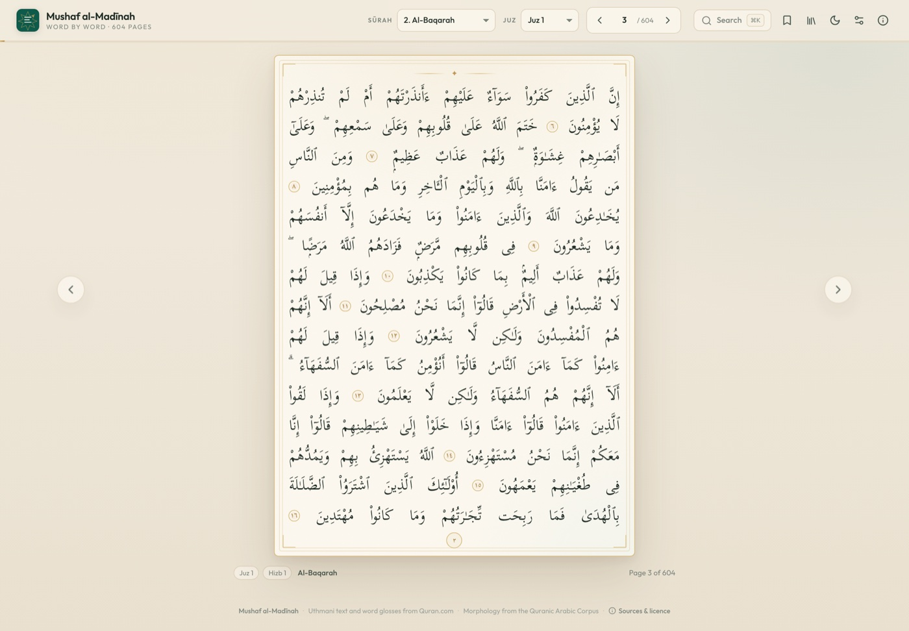
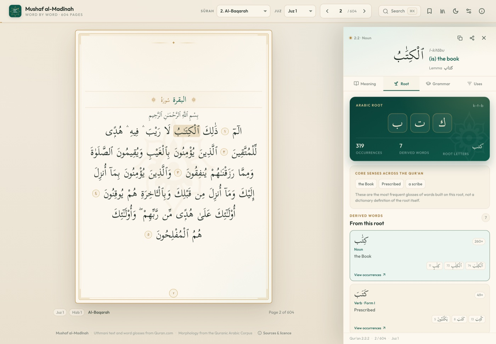
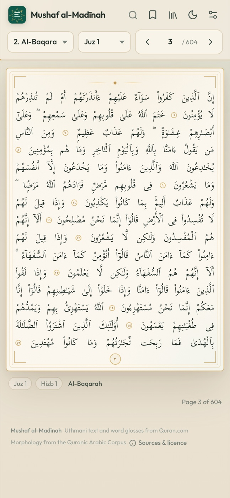

# Mushaf al-Madīnah — Word by Word

An interactive, static reader for the **604-page Madanī Mushaf**. Tap any word to see its
English meaning, its Arabic root and derived words, the grammar at work, and every other
place that word appears in the Qur'an.

**Live site:** <https://ahmedshahmy.github.io/madani-mushaf/>

<p align="center">
  
  
</p>
<p align="center">
  
</p>

## What it does

- **The 604-page Madanī layout.** Pages are laid out on the 15-line grid of the Madinah
  print, with sūrah headings, basmalas, verse-end rosettes and the correct page breaks.
  The text is the Uthmani text; the reader is fully right-to-left.
- **Tap any word.** A side panel opens on desktop and a sheet on mobile:
  - **Meaning** — the word-by-word English gloss and transliteration, the full verse and
    its Saheeh International translation.
  - **Root** — the triliteral root, its core senses, every derived lemma, the verb form,
    frequency and the forms that actually occur in the Qur'an.
  - **Grammar** — part of speech, case/mood, tense, voice, definiteness, attached prefixes
    and pronoun suffixes, plus short explanations of the rules at work.
  - **Uses** — every occurrence of the exact form, the dictionary word (lemma), or the
    whole root, with the surrounding words and a click-through to the page.
- **Search** by Arabic word, English meaning, root transliteration (`k-t-b`), sūrah, page
  or verse reference (`2:255`). <kbd>⌘K</kbd> / <kbd>Ctrl K</kbd>.
- **Reading aids** — page/sūrah/juz navigation, bookmarks, light/dark mode, adjustable
  Arabic size, keyboard page turning, swipe gestures, shareable URLs, and a mobile layout.
- **No backend.** A fully static Vite build; the data is a set of JSON shards that are
  fetched lazily per page or per word family.

## The data

| | |
|---|---|
| Pages | **604** (Madanī, 15 lines) |
| Verses | **6,236** |
| Words | **77,429** |
| Roots | **1,642** |
| Dictionary entries | **4,864** (4,832 corpus lemmas + pronouns and disconnected letters) |

Every word is aligned to the Quranic Arabic Corpus morphology by sūrah, verse and word
position. Roots, lemmas, segments and features are reorganised into small JSON files;
occurrences are grouped by root and lemma. All 77,429 words are verified to land on an
`ayah` line of the 15-line layout, with no words lost or duplicated.

### Sources

- **[Quranic Arabic Corpus](https://corpus.quran.com)** v0.4 — morphology, lemmas, roots,
  segments and grammatical features. © Kais Dukes, University of Leeds; GNU GPL.
- **[Quran.com](https://quran.com)** API — Uthmani word text, word-by-word English glosses,
  transliterations, explicit `v2_page` / `line_v2` placement, and the Saheeh International
  verse translation.
- **[Tanzil Quran Text](https://tanzil.net)** — the verified Uthmani text underlying the
  corpus (CC BY-ND 3.0, reproduced verbatim).
- **[QUL 15-line Madani layouts](https://github.com/blueheron786/quranic-universal-library-mushaf-layouts)**
  — the 15-line page structure and line types used for the sūrah/basmala lines.
- **Fonts** — [Scheherazade New](https://software.sil.org/scheherazade/),
  [Noto Naskh Arabic](https://fonts.google.com/noto/specimen/Noto+Naskh+Arabic) and
  [Outfit](https://fonts.google.com/specimen/Outfit), all under the SIL Open Font License.

Full licence and attribution notices are in [NOTICE.md](NOTICE.md).

> **A note on meaning.** The word glosses are brief guides, not complete definitions; an
> Arabic word can carry several senses in different contexts. Grammar notes are generated
> from corpus features and simplify a rich scholarly discussion. This is a learning tool,
> not a tafsīr. For tafsīr and rulings, consult qualified teachers and scholars.

## How it is built

```
data/raw/                  upstream pages, morphology and layout (not committed)
scripts/fetch_pages.py     fetch the Quran.com pages with explicit page/line fields
scripts/fetch_sources.sh   fetch morphology + QUL layout + pages
scripts/build_data.py      align morphology, build lemmas/roots/features
scripts/build_final.py     emit compact page, root, occurrence and lexicon shards
public/quran/              the generated static bundle (~26 MB)
src/                       React reader
```

The generated data is intentionally committed so the site can be built and deployed
without repeating the upstream fetches.

### Regenerate the data

```bash
bash scripts/fetch_sources.sh   # Python 3, curl, unzip
npm run data                    # build_data.py + build_final.py
npm run verify                  # asserts 604 / 6,236 / 77,429 / 1,642 / 4,864
```

### Local development

```bash
npm install
npm run dev        # http://localhost:5173
npm run build      # type-check + production build in dist/
npm run preview    # preview the build (use --base /madani-mushaf/ for the project path)
```

### Deployment

The live site is served from the **`gh-pages`** branch:

```bash
npm run build
npx gh-pages -d dist -b gh-pages
```

Then set **Settings → Pages → Deploy from a branch → `gh-pages` / root**. The Vite base is
`/madani-mushaf/` for production and `/` for development; set `VITE_BASE` to override it.

## Structure at a glance

- `src/components/PageView.tsx` — the 15-line mushaf page, fit-to-width font sizing,
  sūrah/basmala bands, verse rosettes and clickable words.
- `src/components/WordPanel.tsx` and `src/components/tabs/` — meaning, root, grammar and
  occurrence views.
- `src/lib/grammar.ts` — maps corpus features to English grammar labels and rule cards.
- `src/lib/data.ts` — lazy JSON loading and caches.
- `src/lib/format.ts` — Arabic normalisation (including the Qur'anic dagger alef) and
  Arabic-Indic numerals.

## License

The application code is **GPL-3.0**, because the Quranic Arabic Corpus data is GPL. The
Qur'an text, annotations, translation and layout data retain their own licences and
attributions; see [NOTICE.md](NOTICE.md). This project is not affiliated with Quran.com,
the Quranic Arabic Corpus, or the QUL project.
